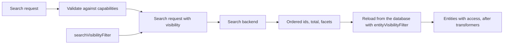

import { Code } from '@astrojs/starlight/components';
import searchDrafts from '@examples/strategies/search-drafts.ts?raw';

`POST /search` goes through the [search backend](/configuration/search/) you pass as `search`. arocapi checks the
request against the backend's capabilities, the backend finds the matching ids, and arocapi loads those entities from
the database and returns them in hit order.

## What the backend sees

arocapi fills in defaults and rejects, with a 400 `VALIDATION_ERROR`, a filter key, sort or search type the backend
doesn't declare, a bad range and geo the backend doesn't support. The backend gets a normalised request: the query,
filters keyed by field name and split into exact terms and ranges, with dates as UTC instants, the page,
the sort and the result of your search visibility filter. The [Search backend](/reference/search-backend/) reference
lists every field.

With either reference backend, the [field declarations](/configuration/search/#fields) decide everything a client can
do:

- **Basic search** matches the `basic` fields, weighted by `weight`. An empty query matches every visible entity.
- **Filters** match exact values, or ranges on `date` and `number` fields: any value within a field, every field. A
  `text` field is filtered on its exact value, not its words.
- **Highlights** of the matched words in basic and advanced fields arrive in each hit's `searchExtra` on
  `OpenSearchBackend`, except on a hit whose Metadata or Content access is denied.
- **Facets** are counted for every declared facet, named by the value and ordered by count, then name; a `date` facet
  has one bucket per UTC year, named `YYYY` and ordered by year. Every declared facet is in every response, empty when
  nothing matches.
- **Geo**: with a `geo` field declared, `boundingBox` filters the hits and `geohashPrecision` counts them per geohash
  cell.
- **Sorts** are any declared sort, or `relevance` (the default), best match first. Missing values sort last and ties
  are broken by id, so paging never repeats or skips an entity.
- **Totals** are exact, however many entities match.

`GET /capabilities` publishes the same filters, facets and sorts, so clients learn what to send.

## Choosing a backend

Both backends take the same field declarations, search documents and search visibility filter, so switching is a
change to the factory call. They differ in how they rank and how much they cost to run:

|                  | `OpenSearchBackend`                                         | `PostgresBackend`                                    |
| ---------------- | ----------------------------------------------------------- | ---------------------------------------------------- |
| Ranking          | BM25: rare words count for more                             | `ts_rank` with field weights, but no rarity (IDF)    |
| Matching         | Per-field analysers, small typos still match                | Whole words, no typos                                |
| Runs on          | A separate OpenSearch cluster                               | The database you already have                        |
| Scale            | Large collections and heavy query load                      | Small collections, fine on a Raspberry Pi            |

Filters, ranges, facets (`date` facets too), geo, sorts, exact totals, the search visibility filter, advanced queries,
the query grammar and errors are the same on both. Only which entities a query's words find, and their relevance
order, differ.

### Lightweight: the Postgres backend

On small hardware, or wherever running OpenSearch isn't worth it, search with Postgres alone:

1. Drop the `opensearch` service from your Compose file, and `@opensearch-project/opensearch` from your packages.
2. Swap `OpenSearchBackend({ client, fields })` from `arocapi/opensearch` for
   [`PostgresBackend({ prisma, fields })`](/configuration/search/#postgresbackend) from `arocapi/postgres`, with the
   same `fields`, and drop the `createIndex()` call.
3. Index your entities again with the same `index` calls. The `EntitySearch` table is already in your database from
   `prisma migrate`.

### Write your own backend

To search another engine, or search differently, implement the [`SearchBackend` contract](/reference/search-backend/):
`capabilities` from `capabilitiesFromFields(fields)`, and `search`, `index` and `remove`. arocapi validates every
request against `capabilities` before your `search` sees it, so the backend only searches: it applies the filters, the
search visibility filter and the sort, and returns ordered ids, an exact total and every declared facet.

## Search and visibility

Your `searchVisibilityFilter` returns a condition over `id` and your declared fields, in
[one language for every backend](/configuration/visibility/#searchvisibilityfilter). arocapi passes it to the backend
as the request's `visibility`, and the backend applies it as a filter beside the query, so hidden entities are excluded
from the hits, from `total` and from every facet count.

arocapi then loads the hits from the database through your `entityVisibilityFilter` as well. A hit that the database
filter hides, or that isn't in the database, is dropped from the page with a warning in the log. `total` and the facets
come from the backend, so they still count it.

Keep the two filters in step: whatever `entityVisibilityFilter` checks in the database has to be in the search
document, as a declared field, and `searchVisibilityFilter` checks the same thing. A field with no role is stored only
for this. For example, if drafts are hidden through a `draft` flag in the entity's `meta`, declare
`draft: { type: 'boolean' }` and index the flag (see
[why the two filters must agree](/concepts/visibility-vs-access/#why-the-two-filters-must-agree)):

<Code code={searchDrafts} lang="ts" />

## Customising search

The reference backends are customised through their options only. To search differently,
[write your own backend](#write-your-own-backend).

The request body and response are under [`POST /search`](/reference/routes/#post-search).
