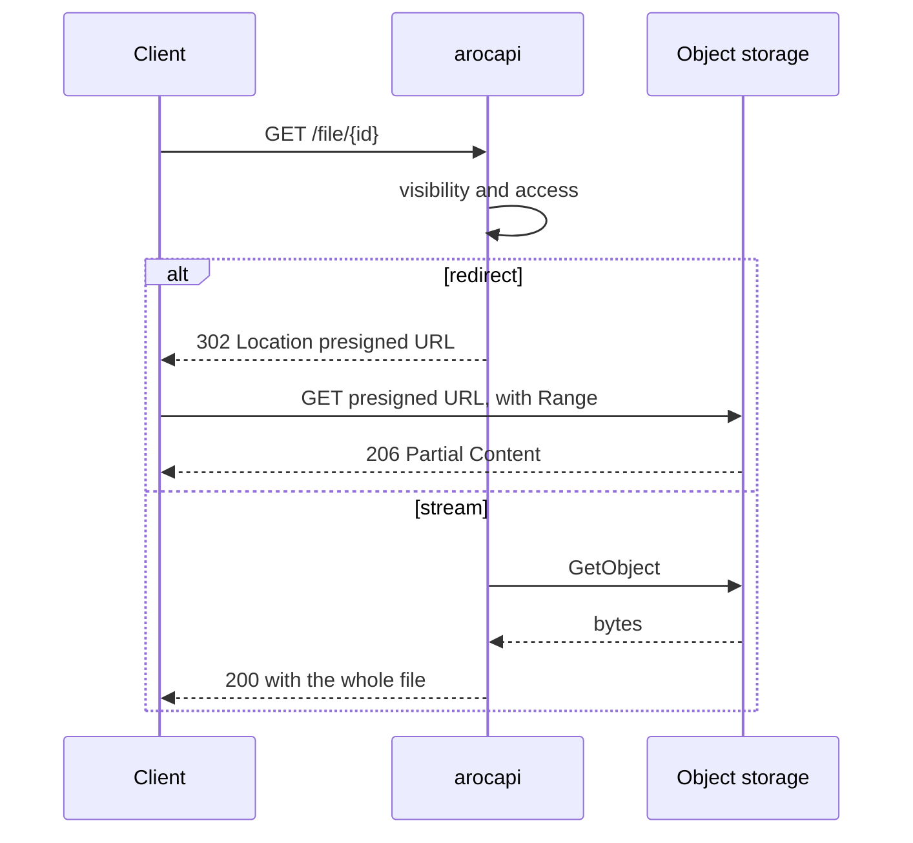

import { Code } from '@astrojs/starlight/components';
import storageMixingOcfl from '@examples/strategies/storage-mixing-ocfl.ts?raw';
import storageRoCrate from '@examples/strategies/storage-ro-crate.ts?raw';
import storageS3Delivery from '@examples/strategies/storage-s3-delivery.ts?raw';

arocapi doesn't know where your files live. A [storage backend](/configuration/storage/) of two halves fetches them
for it: `metadata` serves `/entity/:id/metadata` and `content` serves `/file/:id`. Both run only after the entity is
visible and the request may read it (see [Visibility vs Access](/concepts/visibility-vs-access/)), so a storage
backend never checks access itself.

This page helps you choose: which backend holds your bytes, where Metadata comes from, and how bytes reach the
client. Each backend's options are under [Configuration → Storage](/configuration/storage/), and the `meta` keys
they read under [Entity meta](/reference/entity-meta/#storage-keys).

## Choosing a backend

| Backend | Content delivery | Ranges today | Peer dependencies | Pick it when |
| --- | --- | --- | --- | --- |
| [`DirectoryStorage`](/configuration/storage/#directorystorage) | `path` | No | None | Files sit on a disk the API server can read. |
| [`S3Storage`](/configuration/storage/#s3storage) | presigned `redirect` (default), or `stream` | Yes, on `redirect` | `@aws-sdk/client-s3`, `@aws-sdk/s3-request-presigner` | Files are in a bucket on AWS S3 or another S3-compatible store. |
| [`OcflStorage`](/configuration/storage/#ocflstorage) | `path` | No | `@ocfl/ocfl-fs` (GPL-3.0-or-later) | Files are preserved in an OCFL storage root on local disk, which stays the source of truth. |

The peer dependencies are optional: install only the ones for the backend you import. `@ocfl/ocfl-fs` is licensed
GPL-3.0-or-later, which matters only if you use `OcflStorage` and distribute your app.

If none of these fits, [write your own](#write-your-own).

## Where Metadata comes from

An entity's RO-Crate metadata can come from one of three places:

- **Stored beside the Content.** Each backend's `metadata` half reads `ro-crate-metadata.json` from the same disk,
  bucket or OCFL object as the files. This keeps one source of truth.
- **Kept in the database.** [`EntityMetaMetadata`](/configuration/storage/#entitymetametadata) serves the object your
  indexer wrote to `Entity.meta.rocrate`. Nothing is read from storage, but the copy is only as fresh as your last
  index run.
- **Generated per request.** A `metadata` half of your own builds the document, for example to redact it, and
  returns it as a `json` delivery.

Mix sources by taking one half from each. Here Metadata comes from the database and Content from OCFL:

<Code code={storageMixingOcfl} lang="ts" />

A generated half that redacts contact details from the copy in the database:

<Code code={storageRoCrate} lang="ts" />

arocapi serialises the value once and sets its Content-Length and a strong ETag from those bytes.

## Stream, path or redirect

A `content` half answers with one of three deliveries, which decide who moves the bytes:

| Delivery | Who moves the bytes | Trade-off |
| --- | --- | --- |
| `path` | arocapi, from a file on local disk | Simple and private, but sent whole for now. |
| `stream` | arocapi, from a stream the backend opens | Every byte stays behind your API, and your Node process carries the whole transfer. |
| `redirect` | Whatever serves the URL, such as object storage or a CDN | Offloads the transfer and supports ranges, at the cost of a second request, a second origin and a URL that works for anyone who holds it. |

**Ranges:** an S3 redirect seeks today, and `path` deliveries will once
[Support Range requests on GET /file](https://github.com/crate-works/arocapi/issues/45) lands. Until then, a media
player seeking in a `path` or `stream` file downloads it from the start. For seekable Content from disk or OCFL today,
redirect to a content route of your own, as in the [signed redirect
example](/reference/storage-backend/#example-a-signed-redirect).

`S3Storage` redirects by default. Shorten the expiry, or stream instead:

<Code code={storageS3Delivery} lang="ts" />

When you redirect, plan for:

- **A short presign expiry.** arocapi checks access before it presigns, so the URL is the permission: anyone holding
  it can download the file until it expires. The default is 300 seconds, and a download only has to start within it.
- **Bucket CORS.** A browser client on another origin can only read a redirected response if the bucket's CORS rules
  allow that origin.
- **`?disposition` and `?filename` baked into the URL.** arocapi passes the `Content-Disposition` it computed to the
  `content` half as `contentDisposition`, and `S3Storage` signs it into the URL so the bucket sends it. A backend of
  your own that redirects has to do the same, or the download name is lost.
- **`?noRedirect=true`.** A client that can't follow a cross-origin redirect can call `/file/:id?noRedirect=true`,
  get `200 { "location": url }`, and fetch the URL itself.
- **`HEAD` on a redirect.** `HEAD /file/:id` answers `302` with the presigned URL, but that URL is signed for `GET`,
  so a client that repeats the `HEAD` against `Location` gets `403` from the bucket. To learn the size without the
  body, follow with a `GET` carrying `Range: bytes=0-0` and read the total from `Content-Range`. See
  [#131](https://github.com/crate-works/arocapi/issues/131).

Choose `delivery: 'stream'` when clients can't reach the bucket, such as a store on a private network, or when you
don't want URLs that outlive the access check. Metadata always streams from S3, whichever you choose.

## Write your own

A storage backend is a plain object of two halves, and either half can be your own beside a reference backend's.
[Reference → Storage backend](/reference/storage-backend/) has the contract, the deliveries and what each sends, with
a signed redirect as a worked example.
